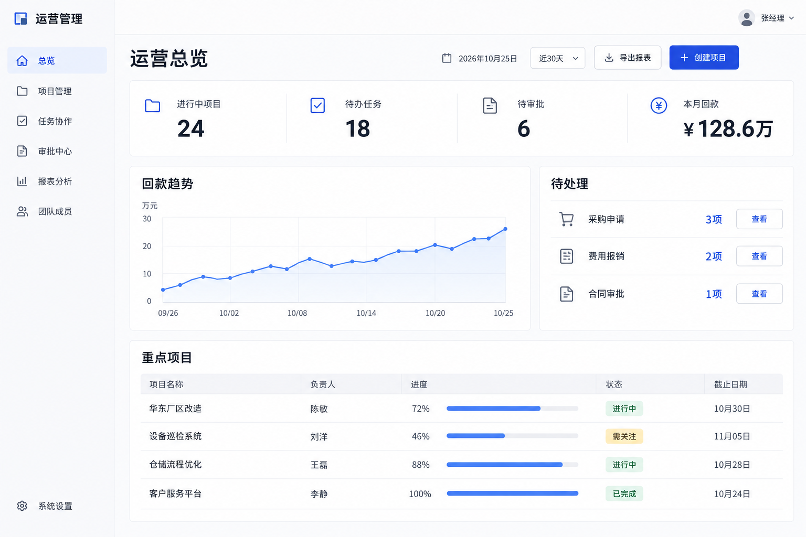
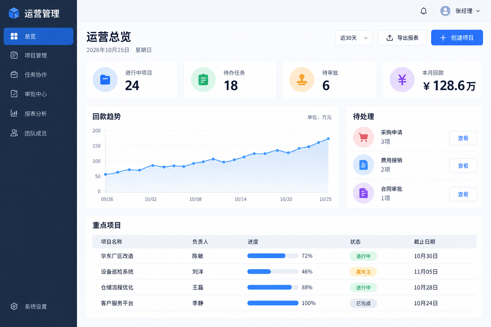
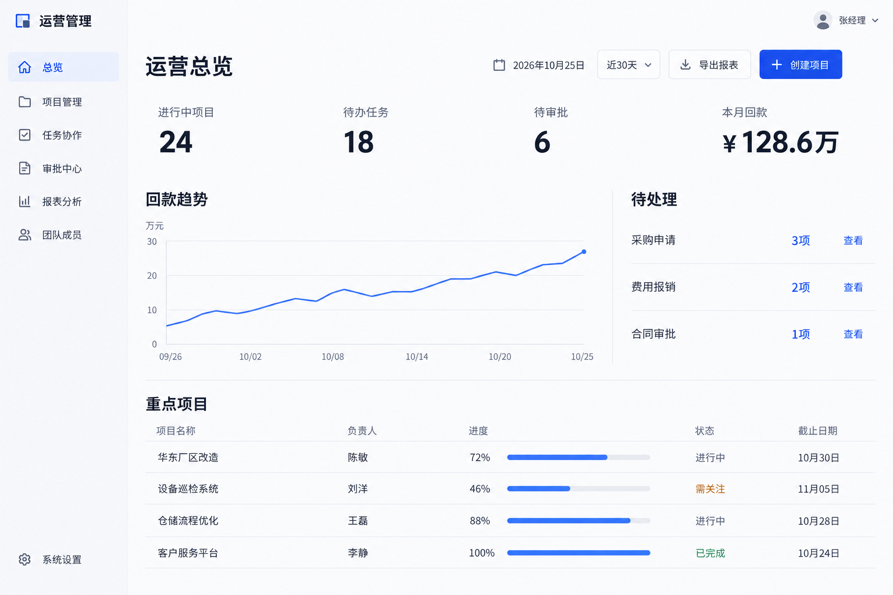

# 案例：适度卡片与过度简化

## 任务与材料

为运营主管生成一张企业运营后台首页，使用相同业务模块和模拟指标：24 个进行中项目、18 项待办、6 项待审批、本月回款 ¥128.6万。页面包括导航、指标、回款趋势、待处理事项与四行重点项目。

三张图都由内置图片生成工具创建，未修改业务页面代码。它们是静态示意，图中文字、像素、曲线和色值未通过源码验证。A 与 B 的走势图数值刻度存在生成差异，不作为严格的数据或效果实验。

## A：应用个人规范的首版

指标合为一个区域，图表、待处理和表格分别分区；保留适量边框和少量功能图标。用户在后续 A 与 A2 的比较中更偏好这一版。

## B：通用要求生成的参考版

与 A 使用同一份业务描述，未附加 Deityki 个人规范。生成时明确要求保持正常专业质量，未要求刻意制造差异。B 不是 Anthropic、Vercel、UI UX Pro Max 或 Impeccable 的运行结果，不能用于这些项目的效果排名。

## A2：继续减少卡片后的方案

用户提出进一步减少卡片和装饰、改善留白对齐。生成时将它执行成了移除全部外围卡片，同时去掉指标图标、图表填色和状态色块。用户明确表示更喜欢原 A 版。

## 已知事实与判断

已知事实：这一次比较中，用户更喜欢 A。判断：适量容器可能让内容归属和扫描路径更清楚，A2 的删减超过了用户预期。没有进行任务计时、可用性测试、跨人群测试或跨模型重复实验，因此不将该解释写成已证实的因果结论。

本案例形成的规则：先保留认可基线，每轮围绕一个可见问题改变主要因素；在减少卡片前检查分组与操作是否仍清楚；若需要更多解释弥补边界丢失，考虑保留容器；用户偏好原版时停止单向简化。

## 提示词记录

[prompts.json](prompts.json) 保存共同业务描述以及 A、B 的实际完整提示词。A2 的变更摘要记录在上文，未在该提示词文件中保存完整原始指令。图片生成具有随机性，该记录用于复现任务和约束，不保证得到相同像素结果。
